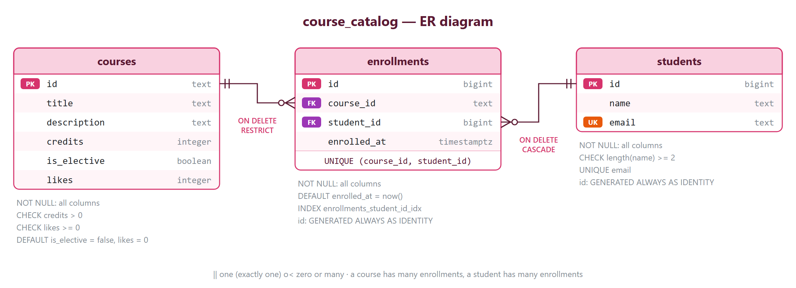
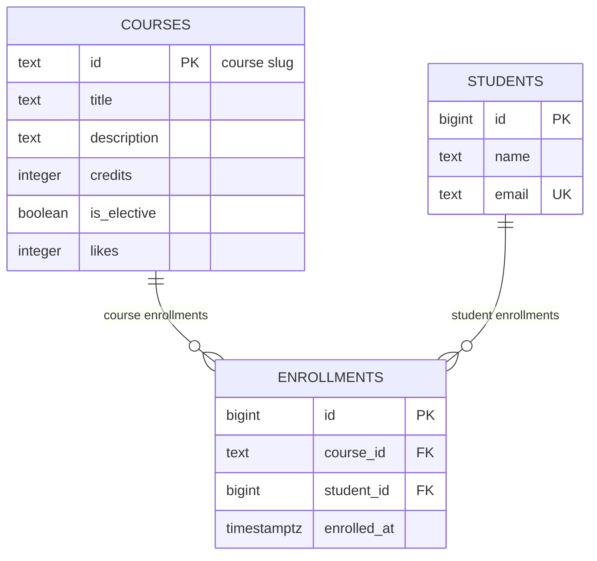

# course-catalog-db

PostgreSQL schema for the course catalog (Lab 6, "Advanced Web Technologies").

## How to run

PostgreSQL 16 or newer is required. Once, as the `postgres` superuser:

```sql
CREATE ROLE catalog_app LOGIN PASSWORD 'change-me';
CREATE DATABASE course_catalog OWNER catalog_app;
```

Then, from the project folder (it stops at the first error):

```bash
psql -h localhost -U catalog_app -d course_catalog -v ON_ERROR_STOP=1 -f schema.sql
psql -h localhost -U catalog_app -d course_catalog -v ON_ERROR_STOP=1 -f seed.sql
psql -h localhost -U catalog_app -d course_catalog -v ON_ERROR_STOP=1 -f queries.sql
```

The password `change-me` is for teaching; real projects keep passwords out of git.

For the index experiment, a throwaway database is used: `CREATE DATABASE idx_demo OWNER catalog_app;`, then `\i schema.sql` and `\i experiments/idx_data.sql` in it.

| File | What it holds |
| --- | --- |
| `schema.sql` | the three tables, keys, constraints, the index on `enrollments.student_id` |
| `seed.sql` | 6 courses, 3 students, 6 enrollments |
| `queries.sql` | queries for the API routes (list, one course, like, enroll, enrollments, statistics) |
| `docs/er-diagram.png`, `docs/er-diagram.svg` | the ER diagram as an image |
| `experiments/idx_data.sql` | 500 courses, 20,000 students and 50,000 enrollments for the index experiment |

## Schema



The same diagram as an image: [`docs/er-diagram.png`](docs/er-diagram.png), vector version [`docs/er-diagram.svg`](docs/er-diagram.svg). Below it is in Mermaid text form:



There are three tables: `courses`, `students` and `enrollments`. A course has many enrollments and a student has many enrollments; each enrollment belongs to exactly one course and one student. Courses and students are linked "many-to-many" through `enrollments`, and the UNIQUE pair `(course_id, student_id)` keeps a student from enrolling in the same course twice.

## Design decisions

- **`courses.id` is text (a slug), `students.id` is an automatic number.** A course slug like `modern-frontend` is stable, readable and already used in the API URLs (`/courses/modern-frontend`), so it works as a natural key; the downside is that it is longer than a number and renaming it means updating every enrollment. Students have no natural identifier: an email can change, and two people can have the same name, so the database issues a surrogate `bigint` number that never changes and is cheap to index; the downside is that the number says nothing by itself and needs a JOIN to show a name.
- **`RESTRICT` on `enrollments.course_id`, `CASCADE` on `enrollments.student_id`.** A course with enrollments is important data: deleting it by mistake would silently erase students' enrollments, so the database refuses (409 in the API) and a person has to decide what to do with the enrollments first. When a student is deleted (for example, their account is removed), their enrollments make no sense without them, so they are deleted together with the student.
- **`timestamptz`, not `timestamp`; `text`, not `varchar(n)`.** `timestamptz` stores a precise moment in UTC and shows it in the client's time zone, so the server and users in different time zones agree on when an enrollment happened; a plain `timestamp` doesn't know which zone it is in. In PostgreSQL `text` and `varchar(n)` are stored the same way and are equally fast; a length limit `n` is a business rule, and it is clearer to write such a rule as a CHECK (like `length(name) >= 2`) than to hide it in the type.

## Constraint violation log

Commands were run with `\set VERBOSITY verbose` on clean data (6 courses, 3 students, 6 enrollments).

| # | What we violate | SQLSTATE | Constraint | API response |
|---|-----------------|----------|------------|--------------|
| 1 | NULL in courses.title | 23502 | NOT NULL has no name: the error names the column `title` (COLUMN NAME) | 422; if Pydantic let an empty title through, it is a bug in the code (500) |
| 2 | courses.credits = 0 | 23514 | `courses_credits_check` | 422 |
| 3 | courses.likes = -1 | 23514 | `courses_likes_check` | 500: only our code changes likes (`likes + 1`), so a negative value means a bug |
| 4 | a one-letter student name | 23514 | `students_name_check` | 422 |
| 5 | a duplicate student email | 23505 | `students_email_key` | 409 Conflict |
| 6 | a duplicate course id | 23505 | `courses_pkey` | 409 Conflict |
| 7 | a repeated enrollment in a course | 23505 | `enrollments_course_id_student_id_key` | 409 Conflict |
| 8 | enrolling in a nonexistent course | 23503 | `enrollments_course_id_fkey` | 404 Course not found |
| 9 | enrolling a nonexistent student | 23503 | `enrollments_student_id_fkey` | 404 Student not found |
| 10 | deleting a course that has enrollments | 23503 on PostgreSQL 16–17, 23001 on 18 | `enrollments_course_id_fkey` | 409 Conflict: a course with enrollments can't be deleted |
| 11 | deleting a student (ON DELETE CASCADE) | no error | `enrollments_student_id_fkey` | the enrollments were deleted by cascade: 6 → 3, back to 6 after ROLLBACK |

Extra check: `INSERT INTO students (id, ...) VALUES (100, ...)` gives `428C9: cannot insert a non-DEFAULT value into column "id"` — the column is `GENERATED ALWAYS`; for the API this is a bug in the code (500).

None of the commands changed the data: after the experiments the tables still hold 6, 3 and 6 rows. The student numbers have gaps (experiment 4 used up number 4): identity guarantees unique numbers, not consecutive ones.

**Why check in the database if Pydantic already checks the name length?** Pydantic protects only requests that go through our API. The database is also written to by other code: migrations, `seed.sql`, admin scripts, psql sessions, a future second service. The CHECK in the database is the last line of defense that holds for every writer, and it keeps the data correct even if someone removes or breaks the check in the code.

## Index: EXPLAIN before and after

Query: `SELECT * FROM enrollments WHERE student_id = 777;`
Database idx_demo: 500 courses, 20,000 students, 50,000 enrollments (`experiments/idx_data.sql`).

| | Before the index | After the index |
|---|------------------|-----------------|
| Access method | Seq Scan on enrollments | Bitmap Index Scan on `enrollments_student_id_idx` + Bitmap Heap Scan |
| cost | 0.00..1042.00 | 4.31..15.59 |
| Rows Removed by Filter | 49997 | — (only the 3 needed rows are read) |
| Execution Time (best of 3) | 1.961 ms | 0.006 ms |

Before the index:

```
Seq Scan on enrollments  (cost=0.00..1042.00 rows=3 width=34) (actual time=0.038..1.957 rows=3 loops=1)
  Filter: (student_id = 777)
  Rows Removed by Filter: 49997
Planning Time: 0.009 ms
Execution Time: 1.961 ms
```

After `CREATE INDEX enrollments_student_id_idx ON enrollments (student_id);`:

```
Bitmap Heap Scan on enrollments  (cost=4.31..15.59 rows=3 width=34) (actual time=0.002..0.003 rows=3 loops=1)
  Recheck Cond: (student_id = 777)
  Heap Blocks: exact=3
  ->  Bitmap Index Scan on enrollments_student_id_idx  (cost=0.00..4.31 rows=3 width=0) (actual time=0.001..0.001 rows=3 loops=1)
        Index Cond: (student_id = 777)
Planning Time: 0.011 ms
Execution Time: 0.006 ms
```

The other two queries already used indexes: `email` — Index Scan using `students_email_key`; `course_id` — Bitmap Index Scan on `enrollments_course_id_student_id_key`. The index costs space: the table takes 3336 kB, the index 896 kB, and every insert, update and delete has to update the index too.

Answers to the questions:

1. PostgreSQL creates an index automatically only for PRIMARY KEY and UNIQUE, because it needs one to check uniqueness. A FOREIGN KEY gets no index. `email` is UNIQUE, and `course_id` is the first column of the UNIQUE pair `(course_id, student_id)`, so a search by `course_id` can use that index. `student_id` is the second column of the pair, and the pair's index doesn't help a search on the second column alone.
2. The planner compares costs. The six rows of `courses` fit on one data page, so reading the whole table (cost 1.07) is cheaper than going through the index first. On `enrollments` with 50,000 rows a full scan reads 1042 cost units, and the index finds 3 rows for about 15.
3. Getting one student's enrollments (`WHERE student_id = ...`), and deleting a student: `ON DELETE CASCADE` has to find all the enrollments of that student, and without the index it would scan the whole `enrollments` table on every delete.

## Transaction

Scenario: enroll a new student in a course — two inserts in one transaction.

- **The second insert failed.** After `BEGIN`, the student Madina Ospanova was inserted (`INSERT 0 1`), and the enrollment in `no-such-course` failed with `ERROR: insert or update on table "enrollments" violates foreign key constraint "enrollments_course_id_fkey"`. The prompt changed to `=!>`: the transaction was aborted, and even a harmless `SELECT count(*) FROM students` was rejected with `current transaction is aborted, commands ignored until end of transaction block`. After `ROLLBACK`, `SELECT count(*) FROM students WHERE email = 'madina@example.com'` returned 0: the first insert was rolled back too, although it was correct on its own.
- **The successful variant in two windows.** Window A ran `BEGIN`, inserted Madina and her enrollment in `web-security`, and didn't commit yet. Window B saw `count = 0` for Madina before `COMMIT` and `count = 1` right after it: both rows appeared at once. The isolation level is `read committed` (`SHOW default_transaction_isolation`): other clients see only committed data. After the commit the database held 4 students and 7 enrollments.
- **Without a transaction**, the first insert would have stayed in the database when the second one failed: a student without an enrollment, "half an operation". The client would get an error, try again, and the second attempt would fail on the duplicate email (`students_email_key`), so the data would have to be fixed by hand.

## Self-review against the checklist

| What to check | Result |
|---------------|--------|
| Keys | yes: every table has a primary key (`courses.id`, `students.id`, `enrollments.id`), and both relationships have foreign keys (`enrollments.course_id`, `enrollments.student_id`) |
| Types | yes: identifiers are `bigint` (identity) or a `text` slug, the moment of enrollment is `timestamptz`, counters are `integer`, the flag is `boolean`; there is no money in the schema |
| Required values | yes: every column is `NOT NULL`, because every field in the domain rules is required; optional values don't exist in this schema |
| Constraints | yes: CHECK `credits > 0`, `likes >= 0`, `length(name) >= 2`; UNIQUE on `email` and on `(course_id, student_id)`; the name rule matches `Field(min_length=2)` in Pydantic |
| Deletion | yes: `RESTRICT` for courses (a course with enrollments can't be deleted by mistake), `CASCADE` for students (their enrollments go with them) — both chosen deliberately and checked in the log |
| Normalization | yes: each fact is stored once — the course title only in `courses`, the student's name and email only in `students`; `enrollments` holds only references; there are no lists in a cell |
| Indexes and names | yes: an index on the foreign key `enrollments.student_id`; `course_id` is covered by the UNIQUE pair index; no extra indexes; names are snake_case, tables are plural, foreign keys are `<table>_id` |
